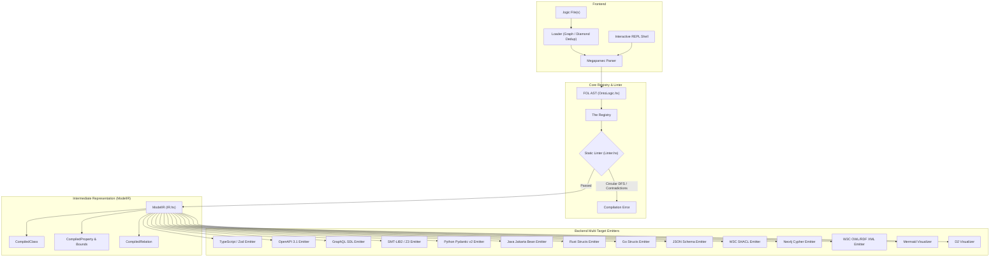

# Project Architecture: OntoLogic

OntoLogic is a **multi-target formal logic transpiler, SMT verification bridge, and interactive REPL**. It follows a classic decoupled compiler architecture:

$$\text{Frontend (Megaparsec DSL / REPL)} \longrightarrow \text{Core Registry AST} \longrightarrow \text{Verification (Linter / Solver)} \longrightarrow \text{ModelIR} \longrightarrow \text{Backend Emitters (14 Targets)}$$

---

## I. Compilation Pipeline

The transpiler treats formal logic as a strongly typed data structure, guaranteeing that business rules, numerical bounds, and relational constraints defined in `.logic` files are structurally preserved across all targets.

---

## II. Compiler Components

### 1. Frontend & Loader (`src/Loader.hs`, `src/Parser.hs`)
- **Megaparsec S-Expression Grammar:** Parses definitions (`def-concept`, `def-property`, `def-relation`, `def-axiom`), quantifiers (`forall`, `exists`), logical connectives (`implies`, `iff`, `and`, `or`, `not`), and numeric literals with sign support.
- **Dependency Graph Loader:** Recursively resolves `(import "...")` directives with cycle detection, diamond import deduplication, and lookup in local and standard library paths (`ontologic-lib/`).

### 2. Static Semantic Linter (`src/Linter.hs`)
- **Taxonomy DAG Analysis:** Detects circular inheritance using Depth-First Search (DFS).
- **Symbol Table Resolution:** Validates undeclared parent concepts, invalid property domains, and undeclared relation ranges.
- **Intra-Axiom Propositional Contradictions:** Flags formulas containing both $P$ and $\neg P$.
- **Cross-Axiom Numerical Interval Contradictions:** Aggregates all lower and upper bounds across axioms per concept and checks for empty interval intersections ($[x \ge a] \land [x \le b]$ where $a > b$).

### 3. Intermediate Representation (`src/IR.hs`)
`ModelIR` decouples the AST from backend targets:
- `CompiledClass`: Fully resolved inheritance hierarchy, topological class sort, direct and inherited properties.
- `CompiledProperty`: Strong ADT property types (`PropertyType`) and normalized bound constraints (`BoundConstraint`).
- `CompiledRelation`: Normalized binary relationships across classes.
- `irUnmappedAxioms`: Identifies complex non-ground axioms that cannot be mapped into basic property constraints and raises target-specific warnings.

### 4. Multi-Prover SMT Solver & Automated Proof-Checking Engine (`src/Solver.hs`)
- **Pluggable Multi-Solver Execution:** Bridges the compiled AST to automated theorem provers (**Z3**, **CVC5**, **Vampire**, or auto-discovery) via stdin streams.
- **Consistency Verification:** Checks whole-ontology satisfiability without full compilation overhead.
- **Taxonomic Subsumption Proofs:** Formulates negated subsumption goals $\neg (A \sqsubseteq B)$ with transitivity and reflexivity axioms, proving theorems when `unsat` and returning concrete counterexamples when `sat`.
- **Empty Concept Detection:** Evaluates isolated concept properties to flag contradictory or unsatisfiable concepts across any supported prover.

### 5. Language Server Protocol (LSP) Engine (`src/LSP.hs`) & VS Code Extension (`editors/vscode/`)
- **JSON-RPC 2.0 Protocol:** Operates over stdio for editor integration with VS Code, Neovim, Emacs, and Helix.
- **Incremental Document Synchronization:** Processes `textDocument/didOpen`, `didChange`, `didSave`, and publishes real-time diagnostic squiggles.
- **IDE Features:** Provides contextual autocompletions (keywords, types, declared concepts/properties), Markdown hover tooltips, and jump-to-definition resolution.
- **VS Code Extension Packaging:** Standalone `.vsix` extension package bundling TextMate syntax grammar (`syntaxes/ontologic.tmLanguage.json`), code snippets, LSP client lifecycle management, and command palette actions for SMT verification.

### 6. Interactive REPL Subsystem (`src/REPL.hs`)
- Maintains an in-memory `REPLState` consisting of the active `Registry` and loaded file paths.
- Provides interactive command dispatch (`:load`, `:show`, `:lint`, `:solve`, `:prove`, `:unsat`, `:ir`, `:emit`, `:clear`) and dynamic parsing of live S-expressions into the session registry.

### 7. Backend Emitters (`src/Emitters/`)
1. **Web & API Formats:**
   - `TypeScript.hs`: Emits TypeScript types and Zod schemas (`z.object`, `z.number().int().gte()`, `.extend()`).
   - `OpenApi.hs`: Emits OpenAPI 3.1 YAML specifications with `allOf` and numerical bounds.
   - `GraphQL.hs`: Emits GraphQL SDL types, scalar fields, and root `Query` fields.
2. **Formal Verification & Theorem Proving:**
   - `SMT.hs`: Emits SMT-LIB2 logic definitions (`declare-sort`, `declare-const`, `declare-fun`, `assert`, `check-sat`, `get-model`) for Z3 and CVC5 solvers.
3. **Enterprise Application Languages:**
   - `Java.hs`: Jakarta Bean Validation (`@NotNull`, `@Min`, `@Max`, `@DecimalMin`, `@DecimalMax`), typed associations, customizable packages.
   - `Python.hs`: Pydantic v2 `BaseModel` classes with topological ordering and `Field` validation.
   - `Rust.hs`: Rust structs with derives and runtime `validate()` methods.
   - `Go.hs`: Go structs with JSON tags and `Validate()` functions.
4. **Knowledge Graphs & Semantic Web:**
   - `Neo4j.hs`: ABox/TBox decoupled schema creation (`:OntologyClass`), typed relationship edges (`-[:REL]->`), and modern audit queries (`elementId(n)`).
   - `Owl.hs`: W3C OWL/RDF XML (`owl:Class`, `owl:DatatypeProperty`, `owl:ObjectProperty`).
   - `JsonSchema.hs`: JSON Schema Draft 2020-12 with `$defs` and numerical constraints.
   - `Shacl.hs`: W3C SHACL Shapes in Turtle syntax (`sh:NodeShape`, `sh:PropertyShape`).
5. **Visual Architecture & Graphing:**
   - `Mermaid.hs`: Class diagrams with inheritance and associations.
   - `D2.hs`: Modern declarative architecture diagrams.

---

## III. Security Architecture & Threat Mitigation

- **Zero Shell Command Injection:** CLI rendering calls binaries directly via `System.Process.callProcess` with argument vectors, avoiding `/bin/sh -c` string evaluation.
- **Identifier Sanitization (`sanitizeIdent`):** Safely translates colon-delimited and hyphen-delimited ontology names (e.g. `ocsf:FileActivity`, `nist-ai:AISystem`) to legal identifiers (`ocsf_FileActivity`, `nist_ai_AISystem`).
- **Cypher Literal Escaping:** Sanitizes single quotes and backslashes in Cypher generation to prevent injection vectors.
- **Environment-Driven Secrets:** All integration scripts and Docker configurations leverage environment variables (`NEO4J_AUTH`, `NEO4J_USER`, `NEO4J_PASSWORD`) with secure defaults.
