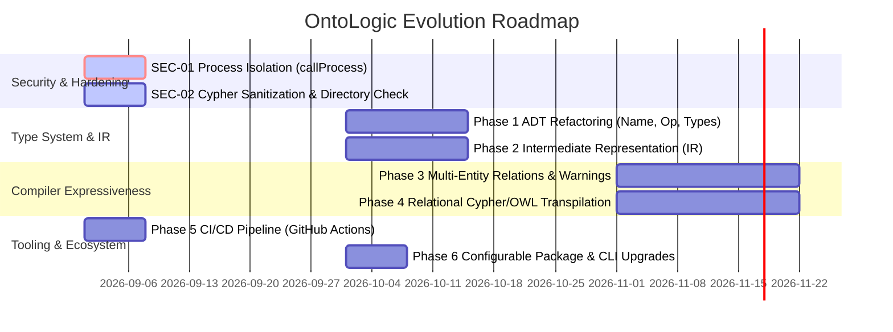

# OntoLogic: Architectural Review & Strategic Recommendations
**Reviewer Model:** Gemini 3.7 Flash (Medium Reasoning)  
**Date:** September 2026  
**Repository:** `bsommers/OntoLogic`  
**Target Baseline:** `main` & `feature/core-improvements` (Milestones 1 & 2)

---

## 1. Executive Summary

OntoLogic tackles an essential challenge in distributed and cyber-physical systems (IoT/IIoT, industrial automation, microservices): **semantic schema drift**. In heterogeneous architectures where JVM gateways, Python edge agents, and Neo4j digital twins interact, domain invariants and validation thresholds frequently diverge across language boundaries.

OntoLogic's stated mission is **"Logic-as-Code"**: using First-Order Logic (FOL) declarative specifications (`.logic` files) as a single source of truth to statically verify mathematical consistency and generate native runtime artifacts across multiple targets (Java Jakarta POJOs, Python Pydantic v2 models, Neo4j Cypher schemas, OWL XML ontologies, and Mermaid/D2 diagrams).

### 1.1 State of the Codebase Post-Milestones 1 & 2
Recent engineering iterations on the `feature/core-improvements` branch have resolved significant early defects:
- ✅ **OWL XML Compliance:** Root tag closure (`</rdf:RDF>`) and standard namespace declarations added.
- ✅ **Python Class Topological Sorting:** `Data.Graph.topSort` integrated to prevent runtime `NameError` on inheritance hierarchies.
- ✅ **Neo4j TBox/ABox Decoupling:** Metamodel taxonomy nodes now use `:OntologyClass` with explicit pre-merge steps and modern `elementId(n)` functions.
- ✅ **Signed Numerical Range Support:** Parser supports negative numbers and floating-point constraints (`@DecimalMin`, `@DecimalMax`, Pydantic `Field`).
- ✅ **Semantic Linter Upgrades:** Symbol table validation (undeclared parents, undeclared domains, duplicate concepts/properties) and cross-axiom interval contradiction checking.
- ✅ **49-Test Verification Suite:** End-to-end testing with examples integration, visualizer emitter specs, CLI driver tests, and live JUnit 5 / Pydantic runtime validation.

### 1.2 Core Architectural Finding
Despite these significant improvements, the codebase exhibits a **fundamental architectural tension**:
The AST and Parser provide a rich First-Order Logic language (quantifiers, implications, negations, biconditionals), but the **Emitter/Extraction layer remains an ad-hoc pattern matcher** that harvests only single-variable numerical bounds `(forall (x) (implies (Concept x) (op property IntegerConstant)))`. 

To evolve OntoLogic from an impressive prototype into a production-grade compiler, the project must:
1. **Eliminate Critical Security Vulnerabilities** (Shell and Cypher injections).
2. **Elevate Type Safety & Eliminate Primitive Obsession** (Replace raw `String` names, types, and operators with formal Haskell ADTs).
3. **Introduce a Formal Intermediate Representation (IR)** between FOL and code generators.
4. **Harden Build, Packaging, and Continuous Integration (CI)**.

---

## 2. Critical Security & Soundness Vulnerabilities

### 🔴 SEC-01: Command Injection in CLI Image Rendering
* **Location:** [`src/Main.hs:94`](src/Main.hs#L94), [`src/Main.hs:103`](src/Main.hs#L103)
* **Vulnerability:** `Main.hs` uses `System.Process.callCommand` to invoke external tools (`mmdc` and `d2`). Because `callCommand` passes strings directly to the system shell (`/bin/sh -c`), any unescaped file path, target name, or `--output` argument containing shell metacharacters (`;`, `&&`, `|`, `` ` ``) results in arbitrary command execution:
  ```haskell
  -- VULNERABLE:
  callCommand $ "mmdc -i " ++ src ++ " -o " ++ svg
  callCommand $ "d2 " ++ src ++ " " ++ svg
  ```
* **Remediation:** Replace `callCommand` with `System.Process.callProcess` or `proc`, which bypasses the shell and executes the binary directly with an argument vector:
  ```haskell
  -- SECURE:
  import System.Process (callProcess)
  
  renderMermaid :: String -> IO ()
  renderMermaid src = do
      let svg = src ++ ".svg"
      putStrLn $ "Rendering to " ++ svg ++ " using mmdc..."
      result <- try (callProcess "mmdc" ["-i", src, "-o", svg]) :: IO (Either IOException ())
      ...
  ```

---

### 🟠 SEC-02: Cypher Injection & Identifier Interpolation
* **Location:** [`src/Emitters/Neo4j.hs:17, 34, 50`](src/Emitters/Neo4j.hs#L17)
* **Vulnerability:** Concept names, property names, and literal values are concatenated directly into Cypher script blocks without escaping or quoting sanitization:
  ```haskell
  -- VULNERABLE:
  emitNode (name, parent) = 
      "MERGE (n:OntologyClass {name: '" ++ name ++ "'})\n" ++ ...
  ```
  If an ontology definition includes single quotes or special characters in concept names or descriptions, the emitted Cypher produces syntax errors or injection vectors.
* **Remediation:** Introduce a Cypher identifier sanitizer and literal escape helper (e.g., escaping `'` as `\'` and enclosing identifiers in backticks when needed).

---

### 🟠 COR-01: Unchecked File IO & Non-Graceful Exits
* **Location:** [`src/Main.hs:49, 56, 60, 64, 68, 73, 81, 87`](src/Main.hs#L49)
* **Issues:**
  1. **Runtime `error` vs `exitFailure`:** On lint validation failure, line 49 executes `error "Validation Failed."`. In Haskell, `error` raises an unhandled runtime exception with a call stack trace rather than cleanly exiting with status code 1.
  2. **Missing Parent Directory Creation:** When writing output files (`writeFile (out ++ "/models.py") ...`), if directory `out` does not exist, the runtime crashes with an `IOException`.
  3. **Unknown Target Exit Code:** Line 87 matches unknown targets, prints a warning to stdout, and exits with status 0 (success) instead of failing.
* **Remediation:**
  - Call `System.Directory.createDirectoryIfMissing True out` prior to emitting files.
  - Use `System.Exit.die` or `putStrLn ... >> exitFailure`.
  - Ensure unknown CLI targets return `exitFailure`.

---

## 3. Semantic & Compiler Design Findings

### 3.1 The FOL Expressiveness Bottleneck & Premise Stripping

```
┌─────────────────────────────────────────────────────────────────────────────┐
│                             OntoLogic Parser                                │
│   Accepts Full FOL: ForAll, Exists, And, Or, Not, Implies, Iff, Predicates   │
└──────────────────────────────────────┬──────────────────────────────────────┘
                                       │
                        [ 90% Logic Discarded Silently ]
                                       │
                                       ▼
┌─────────────────────────────────────────────────────────────────────────────┐
│                           Constraint Extractor                              │
│   Hardcoded Pattern: (forall (x) (implies (Concept x) (op prop val)))        │
│   - Multi-variable relations: DISCARDED                                     │
│   - Existential constraints:  DISCARDED                                     │
│   - Disjunctions/Biconditionals: DISCARDED                                  │
│   - Premise conditions (e.g. is_active): STRIPPED                           │
└─────────────────────────────────────────────────────────────────────────────┘
```

#### Problem Analysis
1. **Premise Stripping Bug:**
   In [`src/OntoLogic.hs:51-53`](src/OntoLogic.hs#L51-L53), `matchesConcept` evaluates:
   ```haskell
   matchesConcept (Predicate name [Var _]) = name == conceptName
   matchesConcept (And p1 p2) = matchesConcept p1 || matchesConcept p2
   matchesConcept _ = False
   ```
   If an axiom defines a state-conditional rule:
   ```lisp
   (forall (g) (implies (and (Gateway g) (is_online g)) (gt battery_level 15)))
   ```
   The compiler matches `Gateway g`, completely ignores `is_online g`, and emits `battery_level > 15` as an unconditional constraint on all Gateways. Inactive or stored devices are thus flagged as invalid.

2. **Silent Discarding of Complex Logic:**
   Axioms with relations (e.g., `(implies (connected_to a b) ...)`), existential constraints, or multi-field dependencies produce zero output in Java, Python, Neo4j, or OWL, with **no warnings emitted to the user**. The user assumes their safety rules are enforced when the generated artifacts are actually unconstrained.

#### Recommendation
- **Constraint Model Classification:** Distinguish between **Single-Concept Invariants** (translatable to OOP field annotations), **Conditional Rules** (translatable to class-level validation methods or Cypher audit queries), and **Cross-Entity Relational Axioms** (translatable to Cypher/OWL).
- **Linter Warning on Untranslated Axioms:** If an axiom cannot be mapped to the selected target emitter, emit a compile-time warning indicating which axioms were omitted from the target artifact.

---

### 3.2 Type Safety & Primitive Obsession

Throughout the core compiler, strings are used where strongly-typed algebraic data types should be:

| Current Representation | Problem | Recommended Type |
| :--- | :--- | :--- |
| `type Name = String` | Can be confused with paths, values, or errors | `newtype ConceptName = ConceptName Text`<br>`newtype PropertyName = PropertyName Text` |
| `rangeType :: String` | Magic strings `"Integer"`, `"Boolean"` scattered across 5 files | `data PropertyType = PTInteger \| PTFloat \| PTDouble \| PTBoolean \| PTString \| PTCustom ConceptName` |
| `(prop, op, val) :: (String, String, String)` | Untyped operators (`"gt"`, `"lte"`) and unparsed literal strings | `data CompOp = OpEq \| OpNe \| OpGt \| OpGte \| OpLt \| OpLte`<br>`data Value = VInt Integer \| VDouble Double \| VString Text \| VBool Bool` |
| `Registry.concepts :: [(Name, Maybe Name)]` | Association list; O(N) lookup; allows duplicate keys | `data ConceptHierarchy = ConceptHierarchy { parents :: Map ConceptName (Maybe ConceptName) }` |

#### Concrete Impact:
In [`src/Emitters/Java.hs:68-70`](src/Emitters/Java.hs#L68-L70):
```haskell
mapType "Integer" = "Integer"
mapType "Boolean" = "boolean"
mapType _         = "String"
```
Any unmapped or misspelled type silently becomes `"String"`. Furthermore, `Boolean` is mapped to the primitive `boolean` while `Integer` is mapped to the boxed object `Integer`. Attaching `@NotNull` to a primitive `boolean` in Java is a known code smell.

---

## 4. Code Quality & Modularity Review

### 4.1 Emitter Duplication (DRY Violation)
Notice the identical property extraction logic in `Java.hs` vs `Python.hs`:

```haskell
-- Java.hs (Line 15)
propertiesToEmit = filter (\p -> domain p == name || (domain p /= name && isInherited name p conceptsList && any (\(prop, _, _) -> prop == propName p) consts && rangeType p == "Integer")) allProps

-- Python.hs (Line 17)
propertiesToEmit = filter (\p -> domain p == name || (domain p /= name && isInherited name p conceptsList && any (\(prop, _, _) -> prop == propName p) consts && rangeType p == "Integer")) allProps
```

Both emitters duplicate:
- Local vs. inherited property determination.
- Numeric constraint association.
- Constraint-to-field binding.

#### Solution: Dedicated Target-Agnostic Model Generator
Introduce an intermediate data structure:
```haskell
data CompiledClass = CompiledClass
  { className    :: ConceptName
  , parentClass  :: Maybe ConceptName
  , directProps  :: [CompiledProperty]
  , inheritedProps :: [CompiledProperty]
  }

data CompiledProperty = CompiledProperty
  { propertyName :: PropertyName
  , propertyType :: PropertyType
  , constraints  :: [BoundConstraint]
  , isOverridden :: Bool
  }
```
Emitters then become pure, simple rendering views over `CompiledClass`, eliminating all domain extraction logic from backend code generators.

---

### 4.2 Hardcoded Vendor Packaging
In [`src/Emitters/Java.hs:16`](src/Emitters/Java.hs#L16):
```haskell
"package com.acme.generated;\n"
```
The Java generator hardcodes a specific vendor package (`com.acme.generated`). This should be configurable via CLI flags (e.g., `--java-package com.myorg.models`) with a sensible default (`com.ontologic.models`).

---

### 4.3 String vs. Text & Performance Considerations
- `Main.hs` reads input files using `Data.Text.IO.readFile`, converting to `Text` for Megaparsec.
- All emitters construct outputs using `String` (`[Char]`) with heavy list concatenation `(++)`.
- In Haskell, `String` is a linked list of characters; repeatedly concatenating long strings in code generators is $O(N^2)$ in allocations.
- **Recommendation:** Standardize internal representations on `Data.Text.Text` and code emitters on `Data.Text.Lazy.Builder` or difference lists (`ShowS` / `unlines`).

---

## 5. Test Suite & Quality Assurance Audit

### 5.1 Test Suite Strengths
- 49 test cases covering all 6 emitters, CLI driver, parser, linter, and examples.
- End-to-end integration tests in `test/ExamplesSpec.hs` executing across all 12 sample models in `examples/`.
- Integration of live runtime validation tests (Python `ast.parse` & Pydantic validation; Java `javac` compilation & JUnit 5 Jakarta validations).

### 5.2 Areas for Improvement
1. **Fragile Exact-String Matching:**
   `JavaSpec.hs`, `PythonSpec.hs`, and `Neo4jSpec.hs` assert exact multiline string matches against generated code. Minor changes to whitespace, comment formatting, or import ordering break multiple tests simultaneously.
   * *Recommendation:* Use structural / substring assertions (e.g. `shouldContain "@Min(1)"`, `shouldContain "class Device(Asset):"`) or parse the emitted output AST.
2. **Missing CI/CD Automation:**
   There is no `.github/workflows/ci.yml` in the repository. Tests, builds, and linting must currently be executed manually.
3. **Absence of Property-Based Testing:**
   OntoLogic's compiler pipeline is an ideal candidate for `QuickCheck` / `Hedgehog`:
   - *Roundtrip Invariance:* For any generated valid `Registry`, `emitPython` produces syntax that parses without error under `ast.parse`.
   - *Linter Soundness:* Contradictory axioms generated by flipping signs or adding `(not P)` always trigger linter errors.

---

## 6. Strategic Execution Roadmap

The following prioritized roadmap outlines the next evolution phases for OntoLogic:



---

### Phase 1: Security & Immediate Hardening (High Priority)
1. **Fix Command Injection:**
   Replace `callCommand` in [`src/Main.hs`](src/Main.hs) with `callProcess` for `mmdc` and `d2`.
2. **Directory & Error Handling:**
   Add `createDirectoryIfMissing True` before file emission; replace `error` with `die` / `exitFailure`.
3. **Sanitize Cypher Generation:**
   Escape string literals and sanitize concept/property names in [`src/Emitters/Neo4j.hs`](src/Emitters/Neo4j.hs).
4. **Establish GitHub Actions CI:**
   Add `.github/workflows/ci.yml` running `stack test --ghc-options="-Wall -Werror"` and Gradle verification.

---

### Phase 2: Type System Refactoring & Intermediate Representation (IR)
1. **Eliminate String Obsession:**
   - Define `data PropertyType = PTInteger | PTFloat | PTDouble | PTBoolean | PTString | PTCustom Name`.
   - Define `data CompOp = OpEq | OpNe | OpGt | OpGte | OpLt | OpLte`.
   - Convert `Registry.concepts` to use `Map Name (Maybe Name)`.
2. **Extract Common Class IR:**
   - Build a `ModelIR` module that pre-computes direct and inherited properties, resolved constraints, and class hierarchies.
   - Refactor `Java.hs` and `Python.hs` to consume `ModelIR`, reducing code generators to pure rendering templates.
3. **Configurable Java Package:**
   - Add `--java-package` flag to CLI options, defaulting to `com.ontologic.models`.

---

### Phase 3: Logic Expressiveness & Compiler Integrity
1. **Premise-Aware Rule Processing:**
   - Detect when an axiom has condition predicates (e.g. `is_active`) and avoid stripping them into unconditional field constraints.
2. **Compile-Time Omission Warnings:**
   - When emitting to targets that cannot represent certain axioms (e.g., existentials or multi-variable relations in Java POJOs), output informative compiler warnings so users are aware of unrepresented logic.
3. **Property-Based Testing Suite:**
   - Implement `QuickCheck` generators for FOL terms and Registry definitions to fuzz-test the parser and linter.

---

## 7. Conclusion

OntoLogic provides a compelling foundation for unified schema validation across modern distributed tech stacks. By closing the security holes in CLI rendering, transitioning from primitive string manipulation to strongly typed intermediate representations, and aligning the emitter pipeline with the true semantics of First-Order Logic, OntoLogic can reliably bridge the gap between formal ontology specifications and production microservice models.
