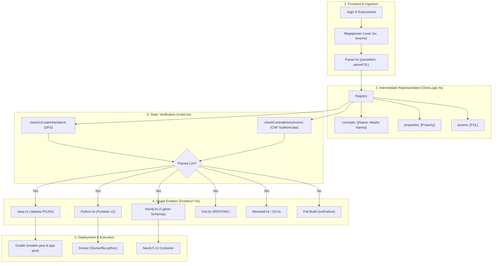

# OntoLogic: Architectural Review & Suggested Improvements

This document provides a critical examination of **OntoLogic**, evaluating its architectural design, stated intent, and the degree to which the current codebase fulfills its goals. It identifies critical bugs, conceptual disconnects, and performance/usability limitations, followed by a prioritized roadmap of actionable improvements.

---

## 1. Executive Summary & Intent vs. Execution Gap

### 1.1 Stated Intent
OntoLogic articulates a compelling value proposition in [docs/purpose_and_motivation.md](docs/purpose_and_motivation.md):
- **Problem**: In distributed IoT/IIoT ecosystems (JVM gateways, Python edge devices, Neo4j digital twins), business rules and safety thresholds drift across platforms, causing silent validation bypasses and hazards.
- **Solution**: A declarative "Logic-as-Code" compiler written in Haskell that uses a single First-Order Logic (FOL) specification (`.logic`) to statically verify mathematical consistency and transpile native, zero-overhead validation models across Java, Python, Neo4j, and OWL.

### 1.2 The Reality: Prototype-to-Production Gap
While the project demonstrates a clean end-to-end proof-of-concept pipeline (Lisp S-expression $\to$ Megaparsec $\to$ Haskell AST $\to$ Emitters), a critical inspection reveals a large gap between the mathematical aspirations and the actual code:

```
┌────────────────────────────────────────────────────────────────────────────┐
│                         AST & Parser Layer                                 │
│  Full First-Order Logic (Predicates, Conjunction, Disjunction, Negation,    │
│  Universal & Existential Quantifiers, Implications, Biconditionals)        │
└─────────────────────────────────────┬──────────────────────────────────────┘
                                      │
                         [ 90% of Logic Discarded ]
                                      │
                                      ▼
┌────────────────────────────────────────────────────────────────────────────┐
│                         Emitter & Extraction Layer                         │
│  Hardcoded pattern extraction: Only recognizes                             │
│  (forall (x) (implies (Concept x) (op property IntegerConstant)))          │
│  Everything else is silently dropped with zero warnings!                   │
└────────────────────────────────────────────────────────────────────────────┘
```

1. **The "Illusion of Safety" Antipattern**:
   The compiler accepts rich FOL expressions (such as existentials in [examples/bfo_unified.logic](examples/bfo_unified.logic) or access rules in [examples/security_policy.logic](examples/security_policy.logic)), reports `✅ Logic Validated successfully.`, but the emitters silently discard them. The developer believes their safety rules are enforced, but the generated models are empty stubs.
2. **Premise Stripping / Miscompilation**:
   When an axiom contains conditional premises—e.g., `(implies (and (Oven o) (is_active)) (gt temperature 100))`—the extractor strips `is_active` and emits `temperature > 100` as an **unconditional** constraint on all `Oven` instances. This turns conditional operational rules into false positives (e.g., flagging an inactive, cold oven as broken).
3. **TBox (Metamodel) vs. ABox (Instance) Confusion in Neo4j**:
   The Cypher generator emits graph nodes for the taxonomy classes themselves (`MERGE (n:Asset {name: 'Asset'})`), then attaches `IS NOT NULL` constraints to label `:Asset`, and generates audit queries against `:Asset`. The metadata nodes immediately violate these constraints and fail the audit queries.
4. **Syntax & XML Specification Breaches**:
   The OWL generator emits syntactically malformed XML (an unclosed `<rdf:RDF>` tag and missing XML namespaces). The Python generator lacks topological sorting, generating subclasses before parents and crashing upon import if concepts are listed out of order.

---

## 2. Architecture Map

The compilation pipeline operates as follows:



### Module Responsibilities & Key Data Types

| Module | Primary Responsibility | Key Types / Functions |
| :--- | :--- | :--- |
| [`src/OntoLogic.hs`](src/OntoLogic.hs) | Core IR, AST definitions, constraint extraction | [`data FOL`](src/OntoLogic.hs#L10-L18), [`data Registry`](src/OntoLogic.hs#L25-L29), [`getLocalConstraints`](src/OntoLogic.hs#L41-L57) |
| [`src/Parser.hs`](src/Parser.hs) | Lexing and recursive descent parsing of S-expressions | [`parseRegistry`](src/Parser.hs#L27-L33), [`parseFOL`](src/Parser.hs#L60-L70), [`parseTerm`](src/Parser.hs#L125-L130) |
| [`src/Linter.hs`](src/Linter.hs) | Static taxonomy cycle checks & formula contradiction audit | [`lintRegistry`](src/Linter.hs#L8-L10), [`checkCircularInheritance`](src/Linter.hs#L12-L23), [`checkRangeContradiction`](src/Linter.hs#L60-L84) |
| [`src/Emitters/Java.hs`](src/Emitters/Java.hs) | Code generator for Java POJOs with Jakarta validation | [`emitJava`](src/Emitters/Java.hs#L7-L9), [`emitFieldOrGetter`](src/Emitters/Java.hs#L26-L47) |
| [`src/Emitters/Python.hs`](src/Emitters/Python.hs) | Code generator for Python Pydantic v2 models | [`emitPython`](src/Emitters/Python.hs#L7-L11), [`mapConstraintToPydantic`](src/Emitters/Python.hs#L39-L50) |
| [`src/Emitters/Neo4j.hs`](src/Emitters/Neo4j.hs) | Cypher script generator (nodes, constraints, audit queries) | [`emitCypher`](src/Emitters/Neo4j.hs#L5-L14), [`emitAuditQuery`](src/Emitters/Neo4j.hs#L29-L35) |
| [`src/Emitters/Owl.hs`](src/Emitters/Owl.hs) | RDF/XML ontology representation | [`emitOwl`](src/Emitters/Owl.hs#L5-L11) |
| [`src/Emitters/Mermaid.hs`](src/Emitters/Mermaid.hs) & [`D2.hs`](src/Emitters/D2.hs) | Architectural diagram generators | [`emitMermaid`](src/Emitters/Mermaid.hs#L6-L12), [`emitD2`](src/Emitters/D2.hs#L6-L11) |
| [`src/Main.hs`](src/Main.hs) | CLI argument parsing, compilation driver, renderer execution | [`main`](src/Main.hs#L37-L50), [`processTarget`](src/Main.hs#L52-L87) |

---

## 3. Critical Bugs & Immediate Flaws (P0)

> **Status (verified 2026-11-07):** all five items below are fixed on `main` and covered by
> regression tests (`OwlSpec`, `IRSpec`/`PythonSpec`, `Neo4jSpec`, `JavaSpec`/`PythonSpec`, `Neo4jSpec`/`GoSpec`).
> Status of later sections is tracked in `.planning/ROADMAP.md`.

### 3.1 OWL Emitter Produces Malformed XML
- **Location**: [`src/Emitters/Owl.hs:13-20`](src/Emitters/Owl.hs#L13-L20)
- **Defect**: The root XML tag `<rdf:RDF` is left unclosed without a trailing `>`:
  ```haskell
  xmlHeader = "<?xml version=\"1.0\"?>\n<rdf:RDF xmlns=\"http://www.acme.com/ontologies/fleet#\"\n"
  ontologyHeader = "    <owl:Ontology rdf:about=\"http://www.acme.com/ontologies/fleet\"/>\n"
  ```
  Standard XML namespaces (`xmlns:rdf`, `xmlns:rdfs`, `xmlns:owl`) are completely missing. Any standard XML or RDF parser (such as Python `xml.etree` or Protégé) immediately crashes with:
  `ParseError: not well-formed (invalid token)`.
- **Fix**: Emit standard XML namespaces and terminate the tag properly:
  ```xml
  <?xml version="1.0"?>
  <rdf:RDF xmlns="http://www.example.com/ontology#"
           xml:base="http://www.example.com/ontology"
           xmlns:rdf="http://www.w3.org/1999/02/22-rdf-syntax-ns#"
           xmlns:rdfs="http://www.w3.org/2000/01/rdf-schema#"
           xmlns:owl="http://www.w3.org/2002/07/owl#">
      <owl:Ontology rdf:about="http://www.example.com/ontology"/>
  ```

### 3.2 Python Emitter Lacks Topological Sorting
- **Location**: [`src/Emitters/Python.hs:11`](src/Emitters/Python.hs#L11)
- **Defect**: Python generates classes sequentially using `concepts reg`:
  ```haskell
  concatMap (emitPythonClass (concepts reg) (axioms reg) (properties reg)) (concepts reg)
  ```
  In Python, if class `B(A)` appears in the file before class `A`, Python raises a runtime `NameError: name 'A' is not defined`. Unlike Java where each public class is written to an independent file, Python requires base classes to be declared before derived classes.
- **Fix**: Implement a topological sort (`Data.Graph.topSort`) on `concepts reg` before emitting Python classes.

### 3.3 TBox / ABox Conflation in Neo4j Emitter
- **Location**: [`src/Emitters/Neo4j.hs:7-35`](src/Emitters/Neo4j.hs#L7-L35)
- **Defect**:
  1. Lines 7-18 emit nodes for the concepts themselves: `MERGE (n:Sensor {name: 'Sensor'})`.
  2. Lines 20-22 emit schema constraints: `CREATE CONSTRAINT FOR (n:Sensor) REQUIRE n.temperature IS NOT NULL`.
  3. Lines 29-35 emit audit queries: `MATCH (n:Sensor) WHERE NOT (n.temperature < 50) RETURN id(n)`.
  Because the concept node `(:Sensor {name: 'Sensor'})` is an ontology metadata node (TBox), it does not have telemetry properties like `temperature`. If constraints run, the script fails. If audit queries run, the metamodel node is returned as a broken IoT device!
- **Fix**: Separate metamodel generation from instance schema constraints. If storing taxonomy in Neo4j, use a distinct label (e.g., `(:OntologyClass {name: 'Sensor'})`) or emit Cypher solely for operational data instances. Also replace deprecated `id(n)` with `elementId(n)`.

### 3.4 Floating-Point Range Constraints Silently Discarded
- **Location**: [`src/Emitters/Java.hs:15, 29-31, 48-65`](src/Emitters/Java.hs#L15), [`src/Emitters/Python.hs:41-50`](src/Emitters/Python.hs#L41-L50)
- **Defect**: In Java:
  ```haskell
  annotations = if rangeType p == "Integer"
                then concatMap mapConstraintToAnnotation pConsts
                else ""
  ```
  In Python:
  ```haskell
  mapConstraintToPydantic rType constraints =
      if rType /= "Integer" then "" else ...
  ```
  In IoT architectures, physical measurements (temperatures, pressures, flow rates, voltages) are almost universally `Float` or `Double`. Because the emitters check `rangeType p == "Integer"`, **all constraints on floating-point properties are silently dropped**.
- **Fix**: Support `Float` and `Double` across emitters. In Java, map constraints to `@DecimalMin` and `@DecimalMax`. In Python, emit `gt` / `lt` on `float` fields.

### 3.5 Premise Stripping and Conditional Miscompilation
- **Location**: [`src/OntoLogic.hs:41-57`](src/OntoLogic.hs#L41-L57)
- **Defect**: `getLocalConstraints` tests:
  ```haskell
  matchesConcept (Predicate name [Var _]) = name == conceptName
  matchesConcept (And p1 p2) = matchesConcept p1 || matchesConcept p2
  ```
  If an axiom is `(forall (o) (implies (and (Oven o) (is_active)) (gt temperature 100)))`, `matchesConcept` matches `Oven o` and immediately extracts `gt temperature 100`. The condition `(is_active)` is discarded. Both Java and Python then enforce that *every* oven must have `temperature > 100` even when powered down.
- **Fix**: Either:
  1. For the **Schema Profile**, flag multi-premise implications in the linter as uncompilable to static fields.
  2. For the **Rule Profile**, transpile the full implication to a method-level validator in Python (`@model_validator`) and Java (`@AssertTrue public boolean isOperationalTemperatureValid()`), or into Drools/CEP rules.

---

## 4. Logic Representation & Semantic Deficiencies (P1)

### 4.1 Lack of Functional Terms / Incoherent Property Syntax
In standard First-Order Logic, a property represents either a binary relation $P(x, y)$ or a function $f(x) = y$. In `.logic` files, axioms are written as:
```lisp
(forall (r) (implies (Refrigerator r) (lt temperature 5)))
```
Here, `temperature` is parsed as `Var "temperature"`. There is no binding between the quantifier variable `r` and the property `temperature`. It reads syntactically as "for all $r$, if $r$ is a Refrigerator, then some arbitrary free variable `temperature` is less than 5."
- **Improvement**: Support standard syntax:
  - Functional syntax: `(lt (temperature r) 5)`
  - Predicate syntax: `(temperature r t) (lt t 5)`

### 4.2 Missing Object Properties & Relation Semantics
Currently, `Property` only supports scalar values:
```haskell
data Property = Property { propName :: Name, domain :: Name, rangeType :: String }
```
When `rangeType` is another concept (e.g., `(def-property has_sensor Machine Sensor)`):
- Java maps it to `private String has_sensor;`
- Python maps it to `has_sensor: str`
- Neo4j maps it to a node property `n.has_sensor` instead of an edge `(m:Machine)-[:HAS_SENSOR]->(s:Sensor)`
- OWL emits an `owl:DatatypeProperty`
- **Improvement**: Introduce distinct AST types for `DatatypeProperty` (concept $\to$ scalar) and `ObjectProperty` (concept $\to$ concept). Emitters must generate class references in Java/Python and edge relationships in Neo4j and OWL.

### 4.3 Missing Cardinality, Optionality, and Defaults
Every property is treated as a required single scalar (`@NotNull` in Java, required attribute without default in Python).
In real domains, many properties are optional (nullable), have default values, or are collections (0..*, 1..*).
- **Improvement**: Add cardinality and nullability qualifiers to `def-property`:
  ```lisp
  (def-property serial_number Asset String :cardinality 1..1)
  (def-property readings Sensor (List Float) :cardinality 0..*)
  (def-property description Asset String :optional True :default "")
  ```

### 4.4 Unimplemented Profile-Based Architecture
[docs/constraint_considerations.md](docs/constraint_considerations.md) laid out a compelling **Profile-Based Architecture** (Schema Profile vs. Rule Profile), but it was never implemented. The compiler still runs a single pipeline that silently drops anything non-conforming.
- **Improvement**: Add an explicit `--profile` flag to the CLI (`schema` vs. `rules` vs. `full`). When targeting `java` or `python` under the `schema` profile, any axiom containing existential quantifiers or unmapped premises must trigger a compiler error or warning rather than silent deletion.

---

## 5. Linter & Verification Engine Enhancements (P1)

### 5.1 No Semantic Symbol Table / Undeclared Reference Checks
The current linter only checks for circular inheritance and localized subformula contradictions. It performs **no symbol resolution**:
- If `(def-concept Sensor Device)` is declared, but `Device` was never defined, the linter silently ignores it.
- If `(def-property temp Sensor Integer)` references a non-existent concept `Sensor`, no error is raised.
- If an axiom references a property `temperature` that does not exist on `Sensor`, it silently passes.
- Duplicate concept or property definitions are silently overwritten by `Map.fromList`.
- **Improvement**: Build a two-pass symbol table validator before running linting:
  1. Pass 1: Register all concept and property names, checking for duplicates.
  2. Pass 2: Verify all parent concepts, property domains, property ranges, and axiom terms exist in the symbol table.

### 5.2 Cross-Axiom & Cross-Hierarchy Contradiction Checking
The contradiction checker in [`Linter.hs`](src/Linter.hs#L28-L31) only inspects conjuncts within a *single* axiom:
- If Axiom 1 states `(forall (s) (implies (Sensor s) (gt temp 100)))` and Axiom 2 states `(forall (s) (implies (Sensor s) (lt temp 50)))`, the linter fails to detect the contradiction!
- If parent concept `Device` restricts `temp <= 40` and child concept `Sensor` restricts `temp >= 50`, the hierarchy is unsatisfiable, but the linter never aggregates inherited constraints.
- **Improvement**: Aggregate all constraints per concept across all axioms and the inheritance chain into an interval map $[min, max]$. Check for empty intervals ($min > max$).

### 5.3 Missing Source Spans in AST
Parse errors print Megaparsec line numbers, but `Registry`, `FOL`, and `Property` contain no source coordinates (`SourcePos`). If the linter finds a circular inheritance or contradiction, it prints raw AST strings (`Axiom contradiction: Predicate "IsActive" [Var "x"] ...`) without file names or line numbers.
- **Improvement**: Annotate AST nodes with `Located a` storing `SourcePos`. Print standard GCC/Rust-style diagnostics:
  ```text
  fleet.logic:12:5: error: range contradiction on property 'temp'
      (implies (Sensor s) (and (gt temp 100) (lt temp 50)))
                                ^~~~~~~~~~~   ~~~~~~~~~~
  ```

---

## 6. Target Emitter Enhancements (P2)

### 6.1 Java Emitter
1. **Configurable Package**: Replace hardcoded `package com.acme.generated;` with a CLI argument (`--package-name`) or config option.
2. **Proper Primitives vs Objects**: Do not put `@NotNull` on primitive `boolean`. Support boxed `Boolean` or use `boolean` consistently.
3. **Serialization & Boilerplate**: Add Jackson annotations (`@JsonProperty`) and constructors / builders to enable practical serialization in Acme broker plugins.
4. **Subclass Methods**: When overriding getters with refined constraints, ensure covariance and annotation inheritance rules match Jakarta Validation specifications.

### 6.2 Python Emitter
1. **Pydantic v2 Idiomatic Code**: Use `Annotated[int, Field(ge=...)]` which is the recommended Pydantic v2 pattern over raw `Field` assignments.
2. **Model Validation for Cross-Field Rules**: When an axiom has multiple fields (e.g. `(implies (is_active) (gt temp 100))`), compile it to a Pydantic `@model_validator(mode='after')`:
   ```python
   @model_validator(mode='after')
   def check_active_temperature(self) -> 'Oven':
       if self.is_active and self.temperature <= 100:
           raise ValueError("Active oven temperature must exceed 100")
       return self
   ```

### 6.3 Neo4j / Cypher Emitter
1. **Parametric & Idempotent Audits**: Emit audit queries as reusable APOC triggers or Cypher scripts that accept `$batch_size` and return descriptive violation records.
2. **Use Neo4j 5 Standards**: Replace `id(n)` with `elementId(n)`.
3. **Graph Relationships**: Generate schema statements for object properties:
   ```cypher
   CREATE CONSTRAINT IF NOT EXISTS FOR ()-[r:HAS_SENSOR]-() REQUIRE r.connected_at IS NOT NULL;
   ```

---

## 7. Developer Experience & Infrastructure (P2)

### 7.1 Gradle Wrapper Missing from Repository
- **Issue**: `.gitignore` contains `gradlew`, `gradlew.bat`, and `gradle/`. Anyone cloning the repo cannot run `./gradlew build` without manually installing Gradle.
- **Fix**: Remove Gradle wrapper entries from `.gitignore` and commit `gradlew`, `gradlew.bat`, and `gradle/wrapper/*`.

### 7.2 Generated Files Polluting Source Tree
- **Issue**: Gradle task `:generateJavaModels` writes directly to `models-java/src/generated/java`, dirtying git status.
- **Fix**: Configure the output directory as `models-java/build/generated/sources/ontologic/java` and register it as a source set in `models-java/build.gradle.kts`.

### 7.3 CLI Ergonomics
- **Issue**: Running `ontologic-exe -t lint` still requires `-o <output>` even though `lint` produces no output files.
- **Fix**: Make `-o` optional for the `lint` target.

---

## 8. Prioritized Implementation Roadmap

```mermaid
gantt
    title OntoLogic Modernization Roadmap
    dateFormat  X
    axisFormat %d

    section Phase 1: Bugfixes (P0)
    Fix OWL XML generation             :active, p1_1, 0, 2
    Add topological sort to Python     :active, p1_2, 1, 3
    Fix TBox/ABox separation in Neo4j  :active, p1_3, 2, 4
    Support Float/Double constraints   :p1_4, 3, 5

    section Phase 2: Semantic Integrity (P1)
    Symbol Table & Reference Checker   :p2_1, 5, 8
    Cross-Axiom Interval Checker       :p2_2, 7, 10
    Warning on Unmapped Axioms         :p2_3, 9, 11
    Source Position (SourcePos) in AST :p2_4, 10, 13

    section Phase 3: Language & Profiles (P2)
    Implement --profile flag           :p3_1, 13, 16
    Object Properties (Graph Edges)    :p3_2, 15, 18
    Pydantic/Jakarta Model Validators  :p3_3, 17, 20
    Gradle Wrapper & Build Cleanup     :p3_4, 19, 21
```



### Milestone Checklist

- [ ] **Phase 1: Critical Bugfixes (Immediate)**
  - [ ] Terminate `<rdf:RDF>` and declare standard W3C XML namespaces in `Owl.hs`.
  - [ ] Sort `concepts` topologically in `Python.hs` to prevent `NameError`.
  - [ ] Use separate labels for Neo4j taxonomy nodes vs. instance constraints; switch `id(n)` to `elementId(n)`.
  - [ ] Support `Float` / `Double` types and Jakarta `@DecimalMin` / `@DecimalMax`.
- [ ] **Phase 2: Semantic Integrity & Linter (Near-term)**
  - [ ] Add Symbol Table resolution pass to catch undefined concepts/properties before code generation.
  - [ ] Emit compiler warnings or errors when axioms contain constructs not supported by the target emitter.
  - [ ] Implement cross-axiom interval aggregation for property ranges.
  - [ ] Attach `SourcePos` to AST elements and enhance diagnostic reporting.
- [ ] **Phase 3: Profiles & Multi-Paradigm Emitters (Mid-term)**
  - [ ] Add `--profile` CLI option (`schema` vs `rules`).
  - [ ] Introduce `ObjectProperty` in the AST and emit graph edges / model references.
  - [ ] Translate conditional implications into `@model_validator` in Python and `@AssertTrue` in Java.
  - [ ] Remove `gradlew` from `.gitignore`, commit Gradle wrapper, and redirect generated sources to `build/`.
