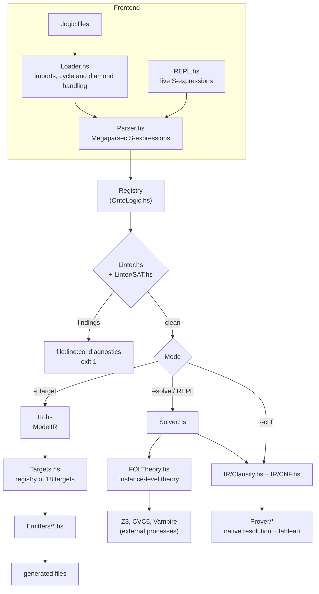
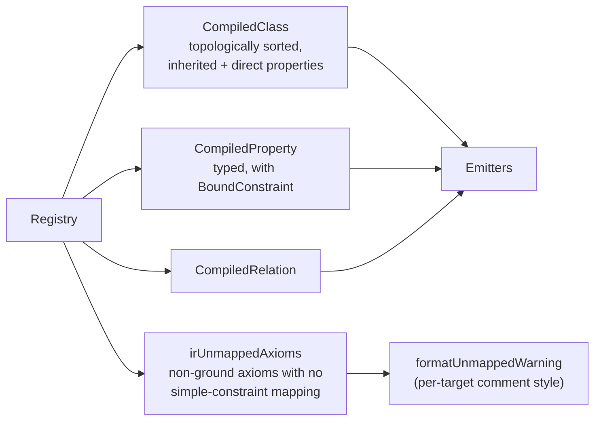
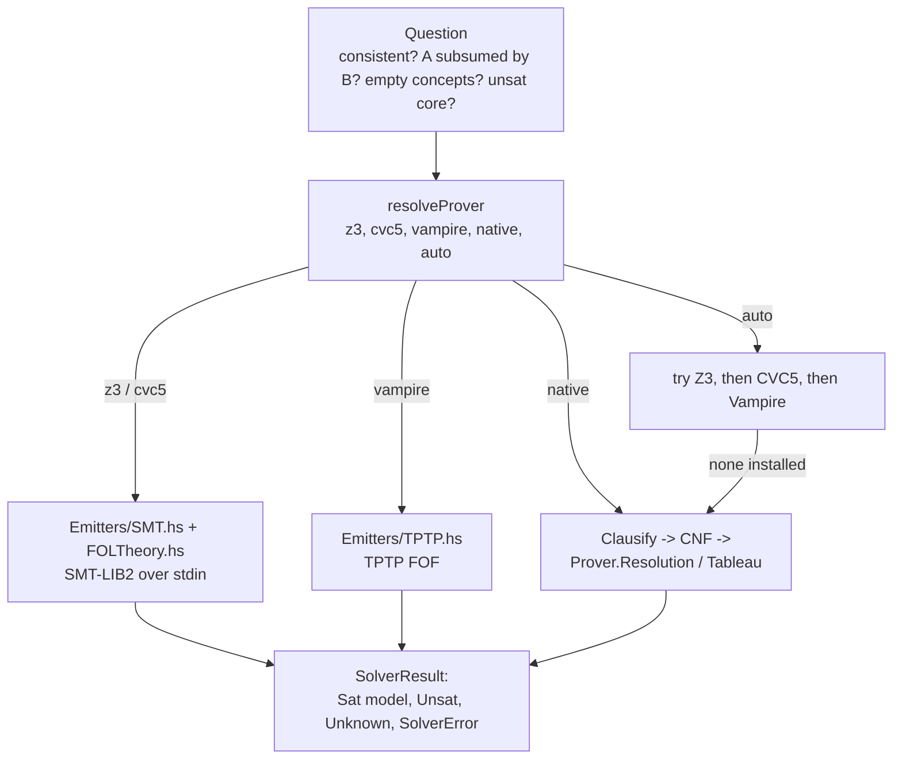

# Architecture

OntoLogic is a classic compiler with a verification stage in the middle: a
frontend parses `.logic` files into one `Registry`, a linter and prover check it,
a normalizing step produces `ModelIR`, and a table-driven backend turns it into
18 output formats. The same core serves the CLI, the REPL and the language
server.

- [Pipeline](#pipeline)
- [Module map](#module-map)
- [Frontend and loader](#frontend-and-loader)
- [Core data model](#core-data-model)
- [Linter](#linter)
- [ModelIR](#modelir)
- [Emitters and the target registry](#emitters-and-the-target-registry)
- [Solvers and provers](#solvers-and-provers)
- [REPL](#repl)
- [Language server and editors](#language-server-and-editors)
- [Security design](#security-design)

## Pipeline

`Main.hs` dispatches in this order: `--lsp`, `--repl`, then load, lint, and
finally `--cnf`, solve, or a target. Lint errors stop everything before any
emitter or solver runs.

## Module map

| Module | Role |
| :--- | :--- |
| `src/Main.hs` | CLI parsing (optparse-applicative), mode dispatch, solver report and exit codes |
| `src/OntoLogic.hs` | Core types: `Registry`, `FOL`, `Term`, `PropertyType`, `BoundConstraint`, `Cardinality`, `RelationDef`, namespaces, imports, source positions |
| `src/Parser.hs` | Megaparsec S-expression parser producing a `Registry` plus a `SourceTable` of positions |
| `src/Loader.hs` | Recursive import resolution, search paths, merge of registries and source tables |
| `src/Linter.hs` | Static semantic checks, GCC-style diagnostics |
| `src/Linter/SAT.hs` | Propositional encoding with Horn and DPLL solving for contradiction and concept-coherence checks |
| `src/IR.hs` | `ModelIR`: resolved classes, properties with bounds, relations, unmapped axioms; warning formatting |
| `src/Targets.hs` | The `targets` table and `lookupTarget`, shared by CLI and REPL |
| `src/Emitters/*.hs` | One module per output family (see below) |
| `src/Solver.hs` | Prover selection, process execution with timeouts, consistency, subsumption, unsat concepts, unsat cores |
| `src/FOLTheory.hs` | Builds the instance-level first-order theory used by SMT-LIB and TPTP solver paths |
| `src/IR/Clausify.hs`, `src/IR/CNF.hs` | Negation normal form, Skolemization and clause types for the native provers |
| `src/Prover/Resolution.hs`, `Tableau.hs`, `Unification.hs` | Dependency-free resolution prover, tableau prover with counter-models, unification |
| `src/REPL.hs` | Interactive session state and commands |
| `src/LSP.hs`, `app-lsp/Main.hs` | JSON-RPC language server over stdio, and its standalone executable |
| `editors/vscode/` | VS Code extension: grammar, snippets, LSP client |

## Frontend and loader

- **Grammar.** Top-level forms are `def-concept`, `def-property`, `def-relation`,
  `def-axiom` (and bare `forall` / `exists` axioms), `namespace` and `import`.
  Formulas use `forall`, `exists`, `implies`, `iff`, `and`, `or`, `not`, equality,
  comparison operators (`gt`, `gte`, `lt`, `lte`) over signed numeric literals,
  and strings. See the [language reference](user-guide/language-reference.md).
- **Positions.** The parser records a `SourceTable` so lint findings can be
  reported as `file:line:col: error: ...` and so the language server can place
  diagnostics and resolve jump-to-definition.
- **Imports.** `Loader.hs` resolves `(import "...")` recursively. It tracks the
  chain of files being visited (a repeat is reported as a circular import with
  the cycle spelled out) and a finished set (a diamond import is loaded once).
  Search order for a relative import: the importing file's directory first, then
  `$ONTOLOGIC_PATH` (`:`-separated), the directory beside the binary, the package
  data directory, `./ontologic-lib`, and the current directory last. Extra
  directories come from the repeatable `--lib-path DIR`. Searching the current
  directory last means a stray local file cannot shadow a standard-library
  module. Absolute paths bypass the search.

## Core data model

`Registry` (in `OntoLogic.hs`) is the single source of truth after parsing:
concepts with parents, properties with domain and type, relations with domain,
range and cardinality, axioms as `FOL` trees, namespace declarations and import
declarations. Everything downstream reads it; nothing mutates it except the REPL,
which appends parsed forms.

## Linter

`lintRegistryDiagnosticsWithSource` checks, in order of concern:

1. Parent concepts, property domains and relation endpoints are declared
   (symbol-table integrity).
2. The taxonomy has no cycles (depth-first search).
3. No duplicate concept or property definitions.
4. No direct contradiction inside one axiom (`P and not P`).
5. Cross-axiom numeric intervals per concept and property are not empty.
6. `Linter/SAT.hs` encodes propositional structure and uses Horn propagation or
   DPLL to catch contradictions and incoherent concepts that no single check
   sees, reporting a derivation chain.

With `--warn-unmapped`, axioms that cannot become simple property constraints are
listed per target instead of being dropped silently.

## ModelIR

`compileRegistry` in `IR.hs` flattens the registry into `ModelIR`:

Bounds are normalized and inherited down the hierarchy. Unmapped axioms are
reported in a comment using each target's own comment syntax; JSON has none, so
`jsonschema` reports them on the CLI only.

## Emitters and the target registry

`Targets.hs` defines `Target { targetName, targetAliases, targetLabel,
targetWarnAs, targetEmit }` and one `targets` list. The CLI (`-t`), the REPL
(`:emit`) and the help text all read that list, so adding a format is one new
module plus one row.

| Family | Targets (aliases) | Output | Module |
| :--- | :--- | :--- | :--- |
| Application languages | `java` | one `<Class>.java` per concept, plus `package-info.java` for warnings | `Java.hs` |
| | `python` | `models.py` (Pydantic v2) | `Python.hs` |
| | `rust` | `models.rs` | `Rust.hs` |
| | `go` (`golang`) | `models.go` | `Go.hs` |
| | `ts` (`typescript`, `zod`) | `models.ts` | `TypeScript.hs` |
| | `cpp` (`c++`) | `models.hpp` (C++20) | `Cpp.hs` |
| Schemas and contracts | `sql` (`postgres`, `postgresql`, `ddl`) | `schema.sql` | `Sql.hs` |
| | `graphql` (`gql`) | `schema.graphql` | `GraphQL.hs` |
| | `openapi` | `openapi.yaml` (3.1) | `OpenApi.hs` |
| | `jsonschema` (`json`) | `schema.json` (2020-12) | `JsonSchema.hs` |
| | `protobuf` (`proto`, `proto3`) | `schema.proto` | `Protobuf.hs` |
| Knowledge and proof | `owl` | `ontology.owl` | `Owl.hs` |
| | `shacl` | `shapes.ttl` | `Shacl.hs` |
| | `neo4j` | `graph.cypher`, `constraints.cypher` (`--neo4j-edition`) | `Neo4j.hs` |
| | `smt` (`smtlib`) | `spec.smt2` | `SMT.hs` |
| | `tptp` (`p`, `fof`) | `theory.p` | `TPTP.hs` |
| Diagrams | `mermaid` | `class_diagram.mmd` | `Mermaid.hs` |
| | `d2` | `diagram.d2` | `D2.hs` |

`--render` shells out to `mmdc` or `d2` using argument vectors, never a shell
string. OWL and SHACL take their base IRI from `--base-iri`, otherwise from the
first declared namespace.

The four non-emitter modes (`lint`, `solve`, `repl`, `lsp`) are handled in
`Main.hs`, not the registry. For per-target details see
[targets and emitters](user-guide/targets-and-emitters.md).

## Solvers and provers

- **Backends.** Z3, CVC5 and Vampire run as external processes fed on stdin.
  `NativeProver` runs in-process on the clausified theory and needs no external
  binary. `auto` (the default) tries each external prover that is installed and
  falls back to native, so `--solve` works on a bare machine.
- **Questions.** Whole-ontology consistency, subsumption (`A` implies `B`,
  checked as the unsatisfiability of the negated goal; `sat` yields a
  counterexample), empty-concept detection (coherence), unsat-core explanation
  and model extraction.
- **Limits.** `--solve-timeout` is enforced on every backend, with a wall-clock
  grace period; `--solve-memory` applies to Z3 only and warns otherwise.
- **Coverage honesty.** Axioms the encoding cannot express are listed before the
  verdict (`untranslatedAxioms`) rather than skipped silently.
- **Exit codes.** `0` consistent and coherent, `1` unsatisfiable, empty concept
  or solver error, `2` the solver answered unknown.

## REPL

`REPL.hs` keeps a `Registry`, the loaded file, the active prover and emit
options. Commands: `:load`, `:show`, `:lint`, `:prover`, `:cnf`, `:solve` /
`:check`, `:explain`, `:model`, `:prove A B`, `:unsat`, `:ir`, `:emit <target>`,
`:set`, `:clear`, `:help`, `:quit`. Anything starting with `(` is parsed and
added to the session. It reuses `Targets.targets`, the linter and the solver.

## Language server and editors

`LSP.hs` is a JSON-RPC 2.0 server over stdio with incremental document sync. It
re-parses and re-lints on `didOpen` / `didChange`, then publishes diagnostics. It
provides completion, hover, definition (following imports through the loader),
rename with prepare, document formatting, semantic tokens, and code actions. Three
commands (`ontologic.solve`, `ontologic.explainUnsat`, `ontologic.inspectModel`)
run the solver asynchronously so the editor stays responsive. It ships as
`ontologic --lsp` and as the `ontologic-lsp` executable (`app-lsp/Main.hs`). The
VS Code extension in `editors/vscode/` bundles the TextMate grammar, snippets and
the client. See [editor and LSP](user-guide/editor-and-lsp.md).

## Security design

- **No shell evaluation.** External tools (`z3`, `cvc5`, `vampire`, `mmdc`, `d2`)
  are launched with argument vectors, never `sh -c` strings.
- **Identifier sanitization.** Names such as `ocsf:FileActivity` or
  `nist-ai:AISystem` become legal identifiers in each target language.
- **Escaping.** Emitters escape string literals for their target language
  (for example Java, Go and Rust strings and Cypher literals).
- **Bounded external work.** Solver runs have timeouts, and the native provers
  run under a configurable limit.
- **Secrets from the environment.** Integration scripts and Docker files read
  credentials such as `NEO4J_AUTH` from environment variables.

## Related

- [Purpose](purpose.md), [Using OntoLogic](using.md),
  [Standard library](standard-library.md), [Developer notes](dev/README.md)
