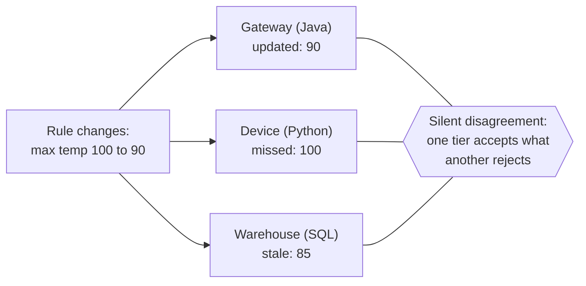
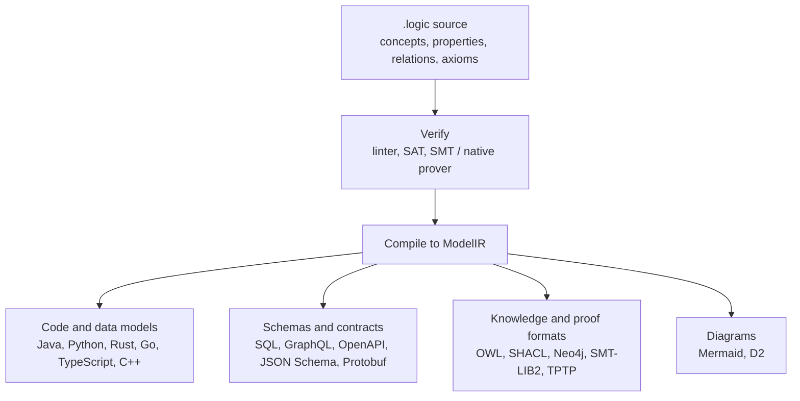

# Purpose: Why OntoLogic Exists

> Complexity is conserved. Either you eliminate semantic ambiguity at the
> foundation, or you pay a compounding "sloppiness tax" of drifting rules,
> inconsistent schemas and hallucinated facts in application code.

OntoLogic is a Haskell First-Order Logic (FOL) ontology DSL and toolchain. You
describe a domain once in a `.logic` file. OntoLogic checks it, proves things
about it, and compiles it to the schemas, models and diagrams your systems need.

- [The problem](#the-problem)
- [The idea: Logic-as-Code](#the-idea-logic-as-code)
- [Why not the alternatives](#why-not-the-alternatives)
- [Three design choices: BFO, FOL, Haskell](#three-design-choices-bfo-fol-haskell)
- [Where it pays off](#where-it-pays-off)
- [Further reading](#further-reading)

## The problem

Modern systems split one domain across many technologies. A single rule such as
"a pump's temperature must stay between 0 and 90 degrees" is re-implemented as a
Java validator on a gateway, a Python model on a device, a SQL check constraint in
the warehouse, a Cypher assertion in a digital twin, an OpenAPI schema on the
REST edge, and a sentence in an LLM prompt.

When the rule changes, someone must find and edit every copy. They never all
match for long. The result is **distributed logic drift**:



Four related failures make it worse:

1. **Flat property graphs and ad-hoc schemas** defer the cost of meaning. One
   team writes `status: "active"`, another `is_active: true`, a third `state: 1`.
   A relationship like `CONNECTED_TO` ends up meaning a cable, a TCP socket and a
   reporting line at once.
2. **LLMs and RAG retrieve plausible text; they do not deduce.** An agent can
   claim an unpowered sensor is reporting, or that software has mass. Retrieval
   cannot enforce invariants.
3. **The academic Semantic Web stack** (RDF, OWL, desktop editors) is rigorous
   but sits outside CI/CD, uses an open-world assumption that is awkward for
   "this field is required" validation, and generates no application code.
4. **Data contracts without logic contracts.** Protobuf, JSON Schema and OpenAPI
   describe shapes. They cannot say "if `risk_score > 7` a mitigation must exist"
   or prove that an inheritance taxonomy has no cycles or contradictions.

## The idea: Logic-as-Code

Define concepts, typed properties, relations and axioms once. Treat the file as
source code: review it, version it, lint it, prove things about it, and generate
everything else from it.



What you get:

- **One source of truth.** A rule change is one edit, then a regenerate.
- **Proofs, not hopes.** Consistency, taxonomic subsumption (`A` is a `B`), and
  empty-concept detection run through Z3, CVC5, Vampire, or the built-in native
  prover.
- **Zero runtime reasoner.** Production systems receive plain generated
  validators and schemas. The heavy reasoning happens at build time.
- **Normal developer workflow.** A CLI, an interactive REPL, a language server,
  and a VS Code extension.

## Why not the alternatives

| Dimension | Ad-hoc code and DTOs | JSON Schema / OpenAPI | RDF / OWL tooling | Property graph | OntoLogic |
| :--- | :--- | :--- | :--- | :--- | :--- |
| Single source of truth | Fragmented | Data shapes only | Ontology only | Database only | Yes |
| Logic and axiom constraints | Hand-coded per app | None | Description logic | None | First-order logic |
| Compile-time proofs | None | None | Slow DL reasoners | None | SMT and native prover |
| Multi-target generation | None | Basic stubs | None | None | 18 emitters |
| Upper-ontology grounding | None | None | Possible | None | BFO and CCO in the standard library |
| Developer ergonomics | Per IDE | Schema linter | Desktop GUI | Browser console | CLI, REPL, LSP |
| Runtime cost | Varies | Low | Heavy reasoner | Query overhead | None (generated code) |

## Three design choices: BFO, FOL, Haskell

**Basic Formal Ontology (BFO, ISO/IEC 21838-2) as the upper layer.** Models of
"concepts" are ideas in minds; models of *universals* describe what exists. BFO
separates things that exist (material entities), things that happen (processes),
and records about them (information content entities). That keeps a socket, a
cable and a social tie from collapsing into one `Connection`, lets mining, cloud
and manufacturing models merge without collisions, and gives you a principled
check against nonsense such as "the software weighs 5 kg" (software is a
generically dependent continuant; only material entities have mass).

**First-order logic as the language of definition.** Triples cannot express
"all pumps have a safety valve" or "if a mining process runs, some excavator
exists". FOL can, and an axiom is a constraint a prover can use to deduce what a
sensor did not report.

```lisp
;; High-risk vulnerabilities require an active mitigation
(forall (v)
  (implies (and (Vulnerability v) (gt risk_score 7))
    (exists (m) (and (Mitigation m) (mitigates m v)))))
```

**Haskell as the implementation language.** Algebraic data types mirror the logic
(`FOL` is a sum type matching the grammar), pure functions make verification
deterministic for the same input, and Megaparsec gives a precise, testable
parser for untrusted `.logic` files.

The trade is explicit: setup cost is higher than a loose graph, maintenance cost
is much lower, and ambiguity is removed once, at the foundation. Alerts become
explainable ("violated axiom 4: active oven must have temperature above 100")
instead of a bare score.

## Where it pays off

- **Industrial and IoT fleets.** One ontology becomes gateway validators, edge
  models and digital-twin schemas, so every tier enforces the same bounds.
- **Security, threat intelligence and compliance.** The standard library covers
  STIX, ATT&CK, D3FEND, NIST and AI-governance frameworks; compliance rules are
  axioms you can check. See the [standard library](standard-library.md).
- **Grounding AI agents.** An agent's proposed actions can be checked against
  domain invariants before they run, so a violation is rejected
  deterministically.
- **Software and systems engineering.** Architecture, delivery and requirements
  models stay consistent with the code generated from them. See the
  [domain gallery](domains/README.md).

## Further reading

- [Architecture](architecture.md): how the toolchain is built.
- [Using OntoLogic](using.md): task-oriented usage.
