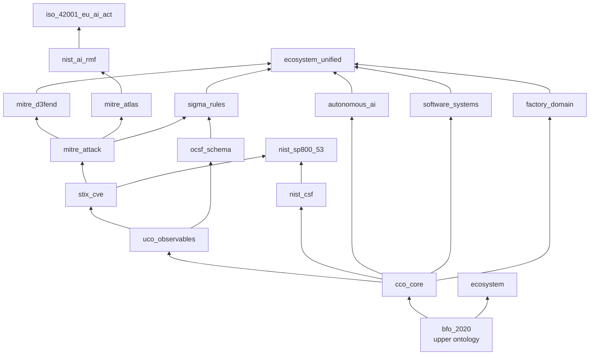

# Standard Library

`ontologic-lib/` ships 19 ready-made `.logic` modules, layered on a common
upper ontology. Import what you need by bare file name; the transitive imports
come with it.

- [How the layers fit](#how-the-layers-fit)
- [Importing](#importing)
- [Upper ontologies](#upper-ontologies)
- [Cybersecurity and threat intelligence](#cybersecurity-and-threat-intelligence)
- [Compliance and AI governance](#compliance-and-ai-governance)
- [Software, systems and factories](#software-systems-and-factories)
- [Instance data](#instance-data)
- [Domain examples](#domain-examples)

Sizes are counted from the files (`def-concept` / `def-relation` forms), so
re-count after editing a module. Tests live in [`test/`](../test/).

## How the layers fit



Arrows point from an imported module to the module that imports it.

## Importing

```lisp
(namespace "cco" "http://www.ontologyrepository.com/CommonCoreOntologies/")

(import "cco_core.logic")        ; also pulls in bfo_2020.logic
(import "mitre_attack.logic")    ; also pulls in stix_cve, uco_observables, cco_core, bfo_2020

(def-concept LateralMovementAlert)
```

Then check or compile as usual:

```bash
ontologic -i my_model.logic -t lint
ontologic -i my_model.logic --solve
ontologic -i my_model.logic -t sql -o out/
```

Imports are searched in the importing file's directory, `$ONTOLOGIC_PATH`, the
directory beside the binary, the package data directory, `./ontologic-lib`, and
the current directory last. Add folders with `--lib-path DIR`. A module imported
by two paths is loaded once. See [architecture](architecture.md#frontend-and-loader).

## Upper ontologies

| File | Covers | Concepts / relations | Imports | Test |
| :--- | :--- | :--- | :--- | :--- |
| `bfo_2020.logic` | Basic Formal Ontology (ISO/IEC 21838-2): continuants, occurrents, material entities, sites, qualities, roles, dispositions, functions, information content entities, processes and temporal regions, with the core relations | 21 / 9 | none | `StandardLibrarySpec.hs`; also imported by `ImportSpec.hs`, `CompileSpec.hs`, `MainSpec.hs`, `LSPSpec.hs`, `SolverSpec.hs` |
| `cco_core.logic` | Common Core Ontologies mid-level: agents and organizations, artifacts and engineered systems, information content entities, acts and planned processes, facilities, and security and reliability qualities | 34 / 8 | `bfo_2020` | `StandardLibrarySpec.hs` |
| `uco_observables.logic` | Unified Cyber Ontology / CASE digital observables: network addresses, ports, sockets and flows, HTTP connections, processes, user accounts, files and certificates | 17 / 6 | `cco_core` | `StandardLibrarySpec.hs` |

## Cybersecurity and threat intelligence

| File | Covers | Concepts / relations | Imports | Test |
| :--- | :--- | :--- | :--- | :--- |
| `stix_cve.logic` | STIX 2.1, CAPEC, CWE and CVE: STIX domain objects (attack patterns, campaigns, indicators, intrusion sets, malware, threat actors, tools), vulnerabilities and weaknesses, with CVSS score bounds and EPSS probability | 17 / 8 | `uco_observables` | `ThreatModelingSpec.hs` |
| `mitre_attack.logic` | ATT&CK Enterprise: the tactic set (initial access through impact), techniques, sub-techniques, mitigations, data sources, groups and software | 21 / 8 | `stix_cve` | `ThreatModelingSpec.hs` |
| `mitre_d3fend.logic` | D3FEND defensive tactics (model, harden, detect, isolate, deceive, evict) and techniques such as network segmentation and process isolation, mapped to ATT&CK | 16 / 7 | `mitre_attack` | `ThreatModelingSpec.hs` |
| `mitre_atlas.logic` | ATLAS adversarial threat matrix for machine-learning systems: prompt injection, evasion, data poisoning, model inversion and extraction, with guardrail mitigations | 19 / 4 | `mitre_attack` | `AIGovernanceSpec.hs` |
| `ocsf_schema.logic` | Open Cybersecurity Schema Framework v1.1.0 event categories and events (file, process, authentication, network, DNS, HTTP activity, security findings) | 14 / 6 | `uco_observables` | `TelemetryMonitoringSpec.hs` |
| `sigma_rules.logic` | Sigma detection rules, detection conditions and severity levels, mapped onto OCSF and ATT&CK | 7 / 3 | `ocsf_schema`, `mitre_attack` | `TelemetryMonitoringSpec.hs` |

## Compliance and AI governance

| File | Covers | Concepts / relations | Imports | Test |
| :--- | :--- | :--- | :--- | :--- |
| `nist_csf.logic` | NIST Cybersecurity Framework 2.0: the six functions (Govern through Recover) and example categories | 14 / 2 | `cco_core` | `ComplianceGRCSpec.hs` |
| `nist_sp800_53.logic` | NIST SP 800-53 Rev 5 control families, representative controls, low/moderate/high baselines, system security plans and assessment findings for compliance-as-code | 22 / 6 | `nist_csf`, `stix_cve` | `ComplianceGRCSpec.hs` |
| `nist_ai_rmf.logic` | NIST AI Risk Management Framework: the Govern, Map, Measure and Manage functions, trustworthy-AI characteristics, AI systems, evaluation metrics and risk profiles | 17 / 4 | `mitre_atlas` | `AIGovernanceSpec.hs` |
| `iso_42001_eu_ai_act.logic` | ISO/IEC 42001 AI management system and EU AI Act risk tiers (prohibited, high, transparency, minimal), lifecycle stages, human oversight and audit records | 13 / 4 | `nist_ai_rmf` | `AIGovernanceSpec.hs` |

## Software, systems and factories

| File | Covers | Concepts / relations | Imports | Test |
| :--- | :--- | :--- | :--- | :--- |
| `software_systems.logic` | Software engineering and systems programming: repositories, branches, commits, pull requests, source files and ASTs, packages, hosts and containers, and build, test, CI and deployment processes | 31 / 10 | `cco_core` | `SoftwareSystemsSpec.hs` |
| `factory_domain.logic` | Software-factory domain: factory roles, instructions and standards, sandboxes, Toulmin-style arguments and verification gates. Vendored copy; the upstream project owns the source | 25 / 5 | `cco_core` | `StandardLibrarySpec.hs` |
| `autonomous_ai.logic` | Autonomous AI and multi-agent swarms: agents, subagents and swarms, role types, foundation models, prompts and context, MCP tools, task execution and evaluation suites with quality gates | 34 / 10 | `cco_core` | `AutonomousAISpec.hs`, `IndustrialBenchmarkSpec.hs` |
| `ecosystem.logic` | Class layer for a code ecosystem: repositories and code symbols bridged to BFO | 5 / 1 | `bfo_2020` | `EcosystemSpec.hs` (also `GraphQLSpec.hs`) |
| `ecosystem_unified.logic` | Mega-ontology that unifies AI agents, software systems, detection, countermeasures and the factory domain, with cross-domain axioms | 5 / 8 | `autonomous_ai`, `software_systems`, `sigma_rules`, `mitre_d3fend`, `factory_domain` | `EcosystemUnifiedSpec.hs`, `IndustrialBenchmarkSpec.hs` |

Concept counts for `ecosystem_unified.logic` are its own additions; the imports
bring the rest.

## Instance data

`ontologic-lib/ecosystem.logic` is tested against a small synthetic Turtle sample,
[`test/fixtures/ecosystem_symbols.ttl`](../test/fixtures/ecosystem_symbols.ttl).
Individuals can also be declared directly with `def-individual` (see the
[language reference](user-guide/language-reference.md)).

## Domain examples

For complete models built on these layers, grouped by sector, see the
[domain examples gallery](domains/README.md).
