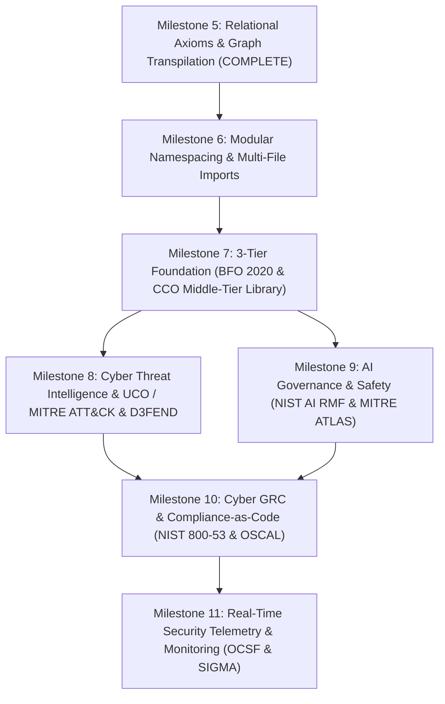

# OntoLogic Future Roadmap & Architectural Plan: 3-Tier Cyber, AI Governance, Threat Modeling & GRC Ontologies

> **Document ID:** `docs/superpowers/plans/2026-09-14-3-tier-cyber-ai-governance-and-grc-roadmap.md`  
> **Methodology:** OpenGSD (Get Stuff Done) Phased Architecture & Execution  
> **Master Reference:** [`docs/superpowers/REPLAY_PLAYBOOK.md`](docs/superpowers/REPLAY_PLAYBOOK.md)

---

## 🎯 Executive Vision: OntoLogic as the Enterprise Security & AI Semantics Engine

OntoLogic's compiler pipeline (parsing First-Order Logic `.logic` DSL files, statically verifying consistency via semantic linting, generating `ModelIR`, and transpiling to multi-target operational code) is uniquely positioned to solve **Security & Governance Drift**.

Modern cybersecurity and AI governance suffer from fractured specifications:
1. **Threat Models & Threat Intelligence** live in MITRE ATT&CK matrices, STIX JSON, and D3FEND graphs.
2. **AI Safety & Risk Policies** live in NIST AI RMF guidelines, MITRE ATLAS matrices, and ISO 42001 / EU AI Act legal texts.
3. **GRC & Security Controls** live in NIST SP 800-53 OSCAL catalogs, SOC 2 spreadsheets, and compliance audits.
4. **Runtime Telemetry & Monitoring** live in OCSF schemas, SIGMA rules, and SIEM/SOAR queries.
5. **Operational Enforcement** lives in disparate Python Pydantic validators, Java microservices, and Neo4j Security Knowledge Graphs.

By establishing a rigorous **3-Tier Ontology Architecture** within OntoLogic, we can define cybersecurity, threat modeling, AI governance, and compliance controls once in mathematical logic and automatically compile them into runtime validation code, database schema constraints, SIEM detection rules, and compliance audit queries.

```
┌───────────────────────────────────────────────────────────────────────────────────┐
│                        TIER 1: TOP-LEVEL UPPER ONTOLOGY                            │
│                 Basic Formal Ontology (BFO 2020 - ISO/IEC 21838-2)                 │
│         Continuant (Material Entity, Quality, Role, Information Entity)           │
│                   Occurrent (Process, Temporal Region, State)                     │
└────────────────────────────────────────┬──────────────────────────────────────────┘
                                         │ is_a / inherits
┌────────────────────────────────────────▼──────────────────────────────────────────┐
│                        TIER 2: MID-LEVEL CORE ONTOLOGIES                           │
│           Common Core Ontologies (CCO) & Unified Cybersecurity Ontology (UCO)      │
│      Agent (Person, SoftwareAgent) │ Artifact (Hardware, NetworkNode, Model)      │
│      InformationEntity (Algorithm, Metric) │ Event (ActOfAccess, Incident)        │
│      UCO Observables (IPAddress, NetworkFlow, Process, File, UserAccount)         │
└────────────────────────────────────────┬──────────────────────────────────────────┘
                                         │ is_a / specializes
┌────────────────────────────────────────▼──────────────────────────────────────────┐
│                    TIER 3: DOMAIN-SPECIFIC OPERATIONAL ONTOLOGIES                  │
│  ┌───────────────────────┬───────────────────────┬─────────────────────────────┐  │
│  │ A. Threat & Defenses  │  B. AI Governance     │  C. Cyber GRC & Compliance  │  │
│  │  - MITRE ATT&CK       │   - MITRE ATLAS       │   - NIST SP 800-53 Rev 5    │  │
│  │  - MITRE D3FEND       │   - NIST AI RMF 1.0   │   - NIST CSF 2.0            │  │
│  │  - CAPEC / CWE / CVE  │   - ISO/IEC 42001     │   - OSCAL Control Baselines │  │
│  │  - STIX 2.1 / TAXII   │   - EU AI Act Matrix  │   - SOC 2 / ISO 27001       │  │
│  └───────────────────────┴───────────────────────┴─────────────────────────────┘  │
│                   │ D. Security Telemetry & Observability                          │
│                   │  - OCSF (Open Cybersecurity Schema Framework)                  │
│                   │  - SIGMA & YARA-L Detection Semantics                          │
└────────────────────────────────────────┬──────────────────────────────────────────┘
                                         │ OntoLogic Compiler & Linter
                                         ▼
┌───────────────────────────────────────────────────────────────────────────────────┐
│                         MULTI-TARGET OPERATIONAL EMITTERS                         │
│  ┌───────────────┐ ┌───────────────┐ ┌───────────────┐ ┌──────────────────────┐   │
│  │ Python Models │ │  Java POJOs   │ │ Neo4j Graph   │ │ W3C OWL / RDF & D2   │   │
│  │ (Pydantic v2  │ │ (Jakarta Bean │ │ (Enterprise   │ │ (Protégé Reasoners,  │   │
│  │  AI Guardrails│ │  Validation,  │ │  Security KG, │ │  Architecture / GRC │   │
│  │  SIEM Parser) │ │  Edge Broker) │ │  Audit Rules) │ │  Executive Diagrams) │   │
│  └───────────────┘ └───────────────┘ └───────────────┘ └──────────────────────┘   │
└───────────────────────────────────────────────────────────────────────────────────┘
```

---

## 🏛️ Foundational Research: The 3-Tier Ontology Model

### Tier 1: Top-Level / Upper Ontology (Foundation)
* **Standard:** **BFO (Basic Formal Ontology - ISO/IEC 21838-2)**.
* **Why BFO?** BFO provides formal ontological rigor preventing category mistakes (e.g. confusing an entity like an AI Model with a process like Model Inference, or confusing a vulnerability with a role).
* **Taxonomy Core:**
  * `bfo:Continuant`:
    * `bfo:IndependentContinuant`: `bfo:MaterialEntity` (Server, Device), `bfo:FiatObjectPart`, `bfo:Site`.
    * `bfo:SpecificallyDependentContinuant`: `bfo:Quality` (Weight, Latency), `bfo:RealizableEntity` (`bfo:Role` like Attacker/Admin, `bfo:Disposition` like Flawed, `bfo:Function` like Encryption).
    * `bfo:GenericallyDependentContinuant`: `bfo:InformationContentEntity` (Software Code, Configuration, Neural Weights).
  * `bfo:Occurrent`:
    * `bfo:Process` (Execution, Packet Transmission, Cyber Attack, Model Training).
    * `bfo:SpatiotemporalRegion` and `bfo:TemporalRegion`.
  * **Primitive Relations:** `bfo:part_of`, `bfo:has_participant`, `bfo:inheres_in`, `bfo:realizes`, `bfo:occupies_temporal_region`.

---

### Tier 2: Mid-Level Core Ontologies (Cross-Domain Bridge)
* **Standards:**
  1. **CCO (Common Core Ontologies - CUBRC / US DoD Standard)**:
     * Built strictly on BFO 2020.
     * Modules:
       * **Agent Ontology (AgO):** `cco:Agent`, `cco:Person`, `cco:Organization`, `cco:AutonomousSoftwareAgent`.
       * **Artifact Ontology (AO):** `cco:Artifact`, `cco:EngineeredSystem`, `cco:HardwareComponent`, `cco:SoftwareArtifact`.
       * **Information Entity Ontology (IEO):** `cco:DesignativeICE` (Identifiers, URIs), `cco:DescriptiveICE` (Logs, Descriptions), `cco:MeasurementICE` (Scores, CVSS, Benchmarks), `cco:DirectiveICE` (Policies, Rules, Requirements).
       * **Event Ontology (EO):** `cco:Act`, `cco:PlannedProcess`, `cco:SystemFailure`, `cco:SecurityEvent`.
       * **Quality Ontology (QO):** `cco:ReliabilityQuality`, `cco:SecurityQuality`.
  2. **UCO / CASE (Unified Cybersecurity Ontology / Cyber-investigation Analysis Standard Expression - OASIS & Linux Foundation)**:
     * Provides concrete definitions for cyber observables and digital forensics:
       * `uco-observable:IPAddress`, `uco-observable:IPv4Address`, `uco-observable:IPv6Address`.
       * `uco-observable:Port`, `uco-observable:NetworkFlow`, `uco-observable:SocketAddress`.
       * `uco-observable:Process`, `uco-observable:File`, `uco-observable:FileSystem`.
       * `uco-observable:UserAccount`, `uco-observable:Certificate`, `uco-observable:HTTPConnection`.
       * `uco-action:Action`, `uco-identity:Identity`, `uco-victim:Victim`.

---

### Tier 3: Domain-Specific Operational Ontologies

#### Pillar A: Threat Intelligence, Threat Modeling & Countermeasures
* **MITRE ATT&CK (Enterprise, Cloud, ICS):**
  * `Tactic` (Initial Access, Execution, Persistence, Privilege Escalation, Defense Evasion, Credential Access, Discovery, Lateral Movement, Collection, Command and Control, Exfiltration, Impact).
  * `Technique` and `SubTechnique` (e.g. `T1059: Command and Scripting Interpreter`, `T1566: Phishing`).
  * `AdversaryGroup` (e.g. `APT28`, `LazarusGroup`).
  * `Software / Malware` (e.g. `Cobalt Strike`, `Mimikatz`).
  * `Mitigation` (`CourseOfAction`).
  * `DataSource` and `DataComponent`.
* **MITRE D3FEND (A Knowledge Graph of Cybersecurity Countermeasures):**
  * Matrix of defensive techniques mapped against digital artifacts:
    * `Model Analysis`, `Process Isolation`, `Memory Hardening`, `Network Segmentation`, `Credential Eviction`.
  * Defensive Relations: `d3f:counters`, `d3f:monitors`, `d3f:detects`, `d3f:isolates`, `d3f:verifies`.
* **STIX 2.1 & CAPEC / CWE / CVE:**
  * STIX Domain Objects (SDOs) and Relationship Objects (SROs): `indicates`, `targets`, `mitigates`, `uses`.
  * `CVE` (Vulnerability), `CWE` (Weakness), `CAPEC` (Attack Pattern).

#### Pillar B: AI Governance, AI Threat Modeling & Safety (AI GRC)
* **MITRE ATLAS (Adversarial Threat Landscape for Artificial-Intelligence Systems):**
  * Specialized matrix for attacks on ML/GenAI systems:
    * `AML.T0051: LLM Prompt Injection` (Direct & Indirect).
    * `AML.T0043: Adversarial Perturbation / Evasion`.
    * `AML.T0018: Training Data Poisoning`.
    * `AML.T0024: Model Inversion & Extraction`.
    * `AML.T0054: LLM Hallucination Exploitation`.
* **NIST AI RMF 1.0 (Artificial Intelligence Risk Management Framework - NIST AI 100-1):**
  * Core Functions: `GOVERN`, `MAP`, `MEASURE`, `MANAGE`.
  * Trustworthy AI Characteristics:
    * `Valid and Reliable`, `Safe`, `Secure and Resilient`, `Accountable and Transparent`, `Explainable and Interpretable`, `Privacy-Enhanced`, `Fair with Harmful Bias Managed`.
* **ISO/IEC 42001:2023 (AI Management System - AIMS) & EU AI Act:**
  * Risk Categories: `Prohibited AI`, `High-Risk AI`, `Specific Transparency Risk (Generative AI)`, `Minimal Risk`.
  * Lifecycles: `TrainingDataCuration`, `ModelEvaluation`, `PostMarketMonitoring`, `HumanInTheLoopOversight`.

#### Pillar C: Cyber GRC & Automated Compliance-as-Code
* **NIST SP 800-53 Rev 5 & OSCAL (Open Security Controls Assessment Language - NIST):**
  * Control Families: `AC (Access Control)`, `AU (Audit & Accountability)`, `CM (Configuration Management)`, `IA (Identification & Authentication)`, `SC (System & Communications Protection)`, `SI (System & Information Integrity)`.
  * OSCAL Machine-Readable Models: Catalogs, Baselines (Low/Mod/High), System Security Plans (SSP), Assessment Plans (AP), Plan of Action & Milestones (POA&M).
* **NIST CSF 2.0 (Cybersecurity Framework):**
  * Functions: `Govern (GV)`, `Identify (ID)`, `Protect (PR)`, `Detect (DE)`, `Respond (RS)`, `Recover (RC)`.
* **SOC 2 Type II & ISO/IEC 27001:2022:**
  * Trust Services Criteria (`Security`, `Availability`, `Confidentiality`, `Processing Integrity`, `Privacy`).

#### Pillar D: Security Telemetry & Monitoring Transpilation
* **OCSF (Open Cybersecurity Schema Framework - AWS, Splunk, IBM):**
  * Categories: `System Activity`, `Network Activity`, `Authentication`, `Discovery`, `Security Findings / Alerts`.
  * Classes: `1001: File Activity`, `2001: Security Finding`, `3001: Authentication`, `4001: Network Activity`.
* **SIGMA Detection Semantics:**
  * Generic rule syntax compiled directly to Cypher audit graph queries and Python stream filters.

---

## 🗺️ OpenGSD Phased Implementation Roadmap



---

### Phase 6 (Milestone 6): Modular Namespacing & Multi-File Imports
> **Goal:** Support modular ontology composition so large standards (BFO, CCO, MITRE) can be split into reusable files and cleanly imported without name collisions.

* **Key Deliverables:**
  1. **DSL Syntax:**
     * `(import "path/to/module.logic")`
     * `(namespace "bfo")` or qualified concept references `(def-concept Server cco:HardwareArtifact)`.
  2. **Parser & Import Resolver:**
     * File dependency resolution with cycle detection in import graph.
     * Qualified and unqualified symbol table lookups.
  3. **Multi-File Intermediate Representation (`ModelIR`):**
     * Module-aware classes and relations tracking provenance file/URI.
  4. **Verification & Tests:**
     * `test/ImportSpec.hs` testing nested imports, transitive imports, and circular import error handling.

---

### Phase 7 (Milestone 7): 3-Tier Foundation: BFO 2020 & CCO Middle-Tier Library
> **Goal:** Create authoritative, fully vetted OntoLogic standard library modules for BFO 2020 and CCO.

* **Key Deliverables:**
  1. **`ontologic-lib/bfo_2020.logic`:**
     * Formal BFO top-level hierarchy (`Continuant`, `Occurrent`, `MaterialEntity`, `Quality`, `Role`, `Disposition`, `Function`, `InformationContentEntity`, `Process`).
     * Foundational BFO relational axioms (`part_of`, `inheres_in`, `has_participant`, `realizes`).
  2. **`ontologic-lib/cco_core.logic`:**
     * Common Core Ontologies: Agent, Artifact, Information Entity, Event, Quality, Spatial, Units of Measure.
  3. **`ontologic-lib/uco_observables.logic`:**
     * Core UCO digital observable concepts (`IPAddress`, `NetworkFlow`, `UserAccount`, `Process`, `FileSystemObject`, `Port`).
  4. **Verification & Tests:**
     * Full linter validation with zero contradictions.
     * Roundtrip OWL/RDF export matching official BFO 2020 and CCO IRIs.

---

### Phase 8 (Milestone 8): Cyber Threat Intelligence, Threat Modeling & MITRE Integration
> **Goal:** Ground threat modeling in MITRE ATT&CK, MITRE D3FEND, and STIX 2.1.

* **Key Deliverables:**
  1. **`ontologic-lib/mitre_attack.logic`:**
     * Concepts for Tactics, Techniques, Subtechniques, ThreatActors, Software, DataSources.
     * Axioms: Techniques require specific platforms, execute with specific privileges, and target specific observables.
  2. **`ontologic-lib/mitre_d3fend.logic`:**
     * Defensive techniques and countermeasure relations (`counters`, `monitors`, `detects`, `isolates`, `verifies`).
  3. **`ontologic-lib/stix_cve.logic`:**
     * STIX 2.1 SDOs/SROs, CWE weaknesses, and CVE vulnerability structures with CVSS rating bounds.
  4. **Threat Transpilation Emitters:**
     * **Neo4j:** Transpiles to an enterprise Security Knowledge Graph (query: "Find all unmitigated ATT&CK techniques matching active CVEs on Internet-facing assets").
     * **Python:** Pydantic threat model validation schemas.
     * **Mermaid / D2:** Attack graph and defense architecture rendering.

---

### Phase 9 (Milestone 9): AI Governance, Safety & Adversarial Threat Modeling (NIST AI RMF & MITRE ATLAS)
> **Goal:** Enable verifiable AI governance, LLM guardrail contracts, and AI vulnerability modeling.

* **Key Deliverables:**
  1. **`ontologic-lib/mitre_atlas.logic`:**
     * MITRE ATLAS matrix for AI attacks (`PromptInjection`, `AdversarialEvasion`, `DataPoisoning`, `ModelExtraction`, `ModelInversion`).
  2. **`ontologic-lib/nist_ai_rmf.logic`:**
     * NIST AI RMF Core: Govern, Map, Measure, Manage functions.
     * Trustworthy AI metrics: `bias_score <= 0.05`, `hallucination_rate < 0.01`, `latency_ms < 500`, `toxicity_score < 0.02`.
  3. **`ontologic-lib/iso_42001_eu_ai_act.logic`:**
     * AI Risk Tiers (`Prohibited`, `HighRisk`, `TransparencyRisk`, `MinimalRisk`) and mandatory conformity constraints.
  4. **AI Guardrail Transpilation:**
     * **Python / Pydantic:** Transpiles to runtime LLM input/output validation guardrails and evaluation benchmark schemas.
     * **Neo4j:** AI System Inventory, lineage, and compliance dependency graph.

---

### Phase 10 (Milestone 10): Cyber GRC & Automated Compliance-as-Code (NIST 800-53 & OSCAL)
> **Goal:** Transform compliance from manual checklists into compiled, verifiable logic.

* **Key Deliverables:**
  1. **`ontologic-lib/nist_sp800_53.logic`:**
     * Control baselines (Low, Moderate, High) across AC, AU, CM, IA, SC, SI families.
  2. **`ontologic-lib/nist_csf.logic`:**
     * CSF 2.0 functions (Govern, Identify, Protect, Detect, Respond, Recover).
  3. **OSCAL Transpiler / Emitter (`-t oscal`):**
     * New emitter `src/Emitters/OSCAL.hs` outputting NIST OSCAL JSON / YAML System Security Plans (SSP) and Component Definitions.
  4. **Continuous Compliance Audit Emitter:**
     * Cypher queries and SQL audit scripts that execute continuous compliance checks against production inventory.

---

### Phase 11 (Milestone 11): Real-Time Security Telemetry & Monitoring (OCSF & SIGMA)
> **Goal:** Bridge static governance and threat models with live operational telemetry.

* **Key Deliverables:**
  1. **`ontologic-lib/ocsf_schema.logic`:**
     * Standard OCSF v1.1.0 security event taxonomy (`SystemActivity`, `NetworkActivity`, `Authentication`, `SecurityFinding`).
  2. **SIGMA Emitter (`-t sigma`):**
     * Compile `.logic` relational axioms into standard SIGMA YAML detection rules for SIEM deployment.
  3. **High-Throughput Stream Parsers:**
     * Java / Acme broker telemetry filter classes and Python streaming parsers enforcing OCSF compliance at ingestion time.

---

## 📈 Summary of Milestone Roadmap

| Milestone | Focus Domain | Primary Standards | Key Artifacts |
|---|---|---|---|
| **M6** | Compiler Core | Modular DSL | `(import ...)`, `(namespace ...)`, import graph resolver |
| **M7** | 3-Tier Foundation | BFO 2020, CCO, UCO | `bfo_2020.logic`, `cco_core.logic`, `uco_observables.logic` |
| **M8** | Cyber Threat Intelligence | MITRE ATT&CK, D3FEND, STIX | `mitre_attack.logic`, `mitre_d3fend.logic`, Attack Graph Cypher |
| **M9** | AI Governance & Safety | NIST AI RMF, MITRE ATLAS, ISO 42001 | `nist_ai_rmf.logic`, `mitre_atlas.logic`, Pydantic AI Guardrails |
| **M10** | Cyber GRC & Compliance | NIST SP 800-53, OSCAL, CSF 2.0 | `nist_sp800_53.logic`, `-t oscal` OSCAL JSON/YAML Emitter |
| **M11** | Telemetry & Monitoring | OCSF, SIGMA | `ocsf_schema.logic`, `-t sigma` SIEM Rule Transpiler |
